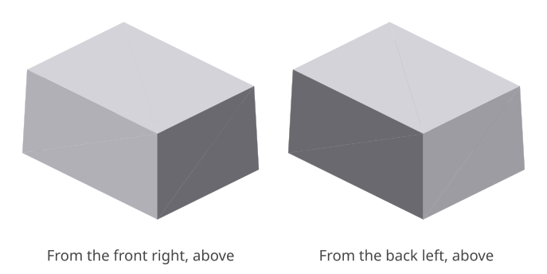
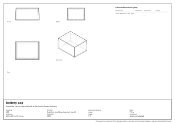

# battery_cap: design report

_A moulded cap: an open shell with drafted walls of even thickness._

## What it is

- **Material:** ABS
- **Process:** Injection moulding, two-part mould
- **General tolerance:** none
- **Mass:** 7.2 g
- **Envelope:** 40.0 x 30.0 x 20.0 mm
- **Quantity:** 5000
- **Appearance:** not seen, not touched

## Requirements and their evidence

| ID | Requirement | Evidence |
|---|---|---|
| R1 | It is one solid. | test `tests/test_battery_cap.py::test_it_is_one_solid` |

## Critical dimensions

None declared in the spec.

## Manufacturability

- **Injection moulding, two-part mould**: no findings.

## Cost

- **injection_moulding**: about **1.71 EUR** each, at 5000 made.
  - material: 7.1 cm³ of ABS at 3 EUR/kg = 0.02
  - machine: 6.9 cm³ built up at 4000 cm³/h = 0 min at 40 EUR/h = 0.07
  - setup: 120 min shared by 5000 = 0.02; tooling: 8000 shared by 5000 = 1.60

A rough figure from volumes and the rates in `design/costs.toml`: for comparing designs and processes, not a quotation.

<!-- generated by codecrew; inputs: c48416344c865a37 -->
