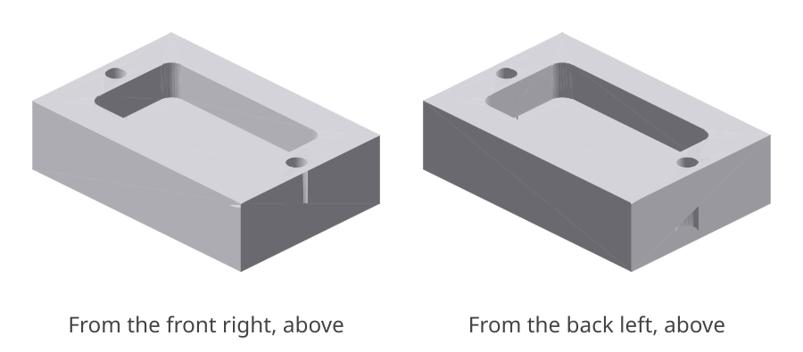
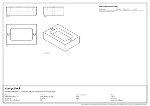

# clamp_block: design report

_A milled clamp block: a pocket with radiused corners and two through holes._

## What it is

- **Material:** Aluminium 6061-T6
- **Process:** CNC milling, 3 axes
- **General tolerance:** none
- **Mass:** 79.7 g
- **Envelope:** 60.0 x 40.0 x 16.0 mm
- **Quantity:** 20
- **Appearance:** not seen, not touched

## Requirements and their evidence

| ID | Requirement | Evidence |
|---|---|---|
| R1 | It is one solid. | test `tests/test_clamp_block.py::test_it_is_one_solid` |

## Critical dimensions

None declared in the spec.

## Manufacturability

- **CNC milling, 3 axes**: no findings.

## Cost

- **milling**: about **4.65 EUR** each, at 20 made.
  - material: 38.4 cm³ of Aluminium 6061-T6 at 6 EUR/kg = 0.62
  - machine: 8.9 cm³ removed from a block at 300 cm³/h = 2 min at 60 EUR/h = 1.78
  - setup: 45 min shared by 20 = 2.25; tooling: 0 shared by 20 = 0.00

A rough figure from volumes and the rates in `design/costs.toml`: for comparing designs and processes, not a quotation.

<!-- generated by codecrew; inputs: be1aed6b5bc6d0f9 -->
