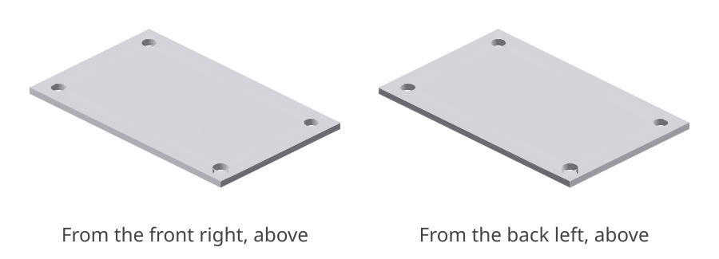
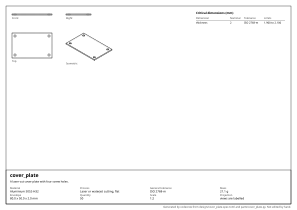

# cover_plate: design report

_A laser-cut cover plate with four screw holes._

## What it is

- **Material:** Aluminium 5052-H32
- **Process:** Laser or waterjet cutting, flat
- **General tolerance:** ISO 2768-m
- **Mass:** 21.1 g
- **Envelope:** 80.0 x 50.0 x 2.0 mm
- **Quantity:** 50
- **Appearance:** not seen, not touched

## Requirements and their evidence

| ID | Requirement | Evidence |
|---|---|---|
| R1 | It is one solid. | test `tests/test_cover_plate.py::test_it_is_one_solid` |

## Critical dimensions

| Dimension | Nominal | Tolerance | Limits | Standard | For |
|---|---|---|---|---|---|
| `thickness_mm` | 2 mm | ISO 2768-m | 1.900 to 2.100 | sheet thickness |  |

## Manufacturability

- **Laser or waterjet cutting, flat**: no findings.

## Cost

- **laser_cutting**: about **0.85 EUR** each, at 50 made.
  - material: 10.2 cm³ of Aluminium 5052-H32 at 5 EUR/kg = 0.14
  - machine: 7.9 cm³ built up at 2000 cm³/h = 0 min at 80 EUR/h = 0.31
  - setup: 15 min shared by 50 = 0.40; tooling: 0 shared by 50 = 0.00

A rough figure from volumes and the rates in `design/costs.toml`: for comparing designs and processes, not a quotation.

<!-- generated by codecrew; inputs: 4bfed93bbee64155 -->
