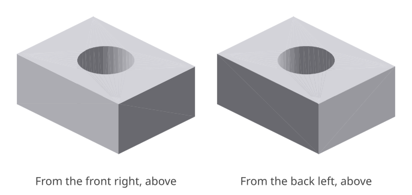
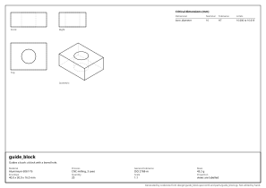

# guide_block: design report

_Guides a bush: a block with a bored hole._

## What it is

- **Material:** Aluminium 6061-T6
- **Process:** CNC milling, 3 axes
- **General tolerance:** ISO 2768-m
- **Mass:** 43.2 g
- **Envelope:** 40.0 x 30.0 x 16.0 mm
- **Quantity:** 20
- **Appearance:** not seen, not touched

## Requirements and their evidence

| ID | Requirement | Evidence |
|---|---|---|
| R1 | The bore goes right through. | test `tests/test_guide_block.py::test_the_bore_goes_through` |

## Interfaces

| ID | Mates with | Dimensions | Fit |
|---|---|---|---|
| I1 | the spacer bush | `bore_diameter_mm` | sliding, H7/g6 |

## Critical dimensions

| Dimension | Nominal | Tolerance | Limits | Standard | For |
|---|---|---|---|---|---|
| `bore_diameter_mm` | 16 mm | H7 | 16.000 to 16.018 |  | I1 |

## Manufacturability

- **CNC milling, 3 axes**: no findings.

## Cost

- **milling**: about **3.20 EUR** each, at 20 made.
  - material: 19.2 cm³ of Aluminium 6061-T6 at 6 EUR/kg = 0.31
  - machine: 3.2 cm³ removed from a block at 300 cm³/h = 1 min at 60 EUR/h = 0.64
  - setup: 45 min shared by 20 = 2.25; tooling: 0 shared by 20 = 0.00

A rough figure from volumes and the rates in `design/costs.toml`: for comparing designs and processes, not a quotation.

<!-- generated by codecrew; inputs: 01f3e213dd20a740 -->
