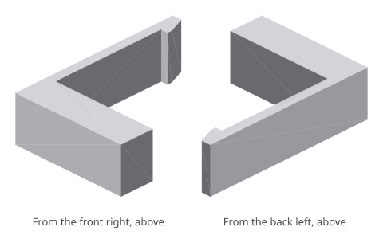
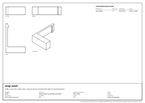

# snap_latch: design report

_Holds a cover shut: a block with a snap arm that hooks behind the edge of a housing window._

## What it is

- **Material:** PETG
- **Process:** 3D printing, fused filament (FDM)
- **General tolerance:** ISO 2768-c
- **Mass:** 1.6 g
- **Envelope:** 20.0 x 29.8 x 8.0 mm
- **Quantity:** 20
- **Appearance:** not seen, not touched

## Requirements and their evidence

| ID | Requirement | Evidence |
|---|---|---|
| R1 | The arm survives being snapped in and out. | L1: safety factor 2.5 (needs 2) |
| R2 | It hooks 1.2 mm behind the edge. | `hook_depth_mm` = 1.2 mm, ISO 2768-c: 1.000 to 1.400; test `tests/test_snap_latch.py::test_the_hook_stands_proud_by_its_depth` |

## Interfaces

| ID | Mates with | Dimensions | Fit |
|---|---|---|---|
| I1 | the edge of the housing window | `hook_depth_mm` | snaps behind the edge |

## Critical dimensions

| Dimension | Nominal | Tolerance | Limits | Standard | For |
|---|---|---|---|---|---|
| `hook_depth_mm` | 1.2 mm | ISO 2768-c | 1.000 to 1.400 |  | I1, R2 |

## Manufacturability

- **3D printing, fused filament (FDM)**: no findings.

## Strength

| Load | What | Calculation | Result |
|---|---|---|---|
| L1 | Snapping in: the hook is pushed aside by its own depth, each time the cover is closed. | snap arm: an arm 20 mm long and 1.6 mm thick, pushed aside 1.2 mm: 0.72% strain at its root, 1.80% permissible for PETG, opened often; safety factor 2.5, needs 2 | carried |

Hand calculations for a straight member of constant section under a static load (`standards/strength.py`): a first check, not an analysis. Fatigue, creep, impact, buckling and the stress around details are not covered.

## Cost

- **fdm**: about **0.42 EUR** each, at 20 made.
  - material: 1.4 cm³ of PETG at 25 EUR/kg = 0.04
  - machine: 1.3 cm³ built up at 15 cm³/h = 5 min at 4 EUR/h = 0.34
  - setup: 10 min shared by 20 = 0.03; tooling: 0 shared by 20 = 0.00

A rough figure from volumes and the rates in `design/costs.toml`: for comparing designs and processes, not a quotation.

<!-- generated by codecrew; inputs: b73840c87dfac799 -->
