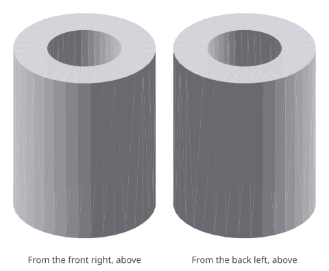
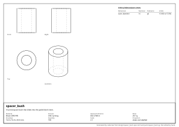

# spacer_bush: design report

_A turned spacer bush that slides into the guide block's bore._

## What it is

- **Material:** Brass CW614N
- **Process:** CNC turning
- **General tolerance:** ISO 2768-m
- **Mass:** 24.7 g
- **Envelope:** 16.0 x 16.0 x 20.0 mm
- **Quantity:** 100
- **Appearance:** not seen, not touched

## Requirements and their evidence

| ID | Requirement | Evidence |
|---|---|---|
| R1 | It is one solid. | test `tests/test_spacer_bush.py::test_it_is_one_solid` |

## Interfaces

| ID | Mates with | Dimensions | Fit |
|---|---|---|---|
| I1 | the bore of the guide block | `outer_diameter_mm` | sliding, H7/g6 |

## Critical dimensions

| Dimension | Nominal | Tolerance | Limits | Standard | For |
|---|---|---|---|---|---|
| `outer_diameter_mm` | 16 mm | g6 | 15.983 to 15.994 |  | I1 |

## Manufacturability

- **CNC turning**: no findings.

## Cost

- **turning**: about **0.97 EUR** each, at 100 made.
  - material: 5.1 cm³ of Brass CW614N at 9 EUR/kg = 0.39
  - machine: 2.2 cm³ removed from a block at 400 cm³/h = 0 min at 55 EUR/h = 0.30
  - setup: 30 min shared by 100 = 0.28; tooling: 0 shared by 100 = 0.00

A rough figure from volumes and the rates in `design/costs.toml`: for comparing designs and processes, not a quotation.

<!-- generated by codecrew; inputs: 2d1f6e9c6c6afdaa -->
