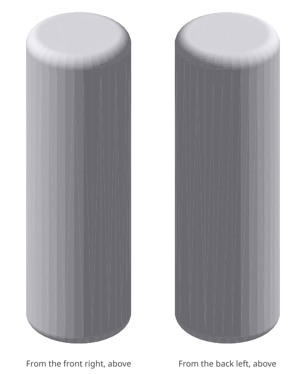
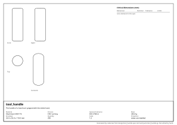

# tool_handle: design report

_The handle of a hand tool: gripped with the whole hand._

## What it is

- **Material:** Aluminium 6061-T6
- **Process:** CNC turning
- **General tolerance:** ISO 2768-m
- **Mass:** 283.8 g
- **Envelope:** 35.0 x 35.0 x 110.0 mm
- **Quantity:** 200
- **Appearance:** seen, touched; black, anodised

## Requirements and their evidence

| ID | Requirement | Evidence |
|---|---|---|
| R1 | It is one solid, round about its axis. | test `tests/test_tool_handle.py::test_it_is_one_solid` |

## Critical dimensions

None declared in the spec.

## Manufacturability

- **CNC turning**: no findings.

## Cost

- **turning**: about **6.40 EUR** each, at 200 made.
  - material: 134.8 cm³ of Aluminium 6061-T6 at 6 EUR/kg = 2.18
  - machine: 29.6 cm³ removed from a block at 400 cm³/h = 4 min at 55 EUR/h = 4.07
  - setup: 30 min shared by 200 = 0.14; tooling: 0 shared by 200 = 0.00

A rough figure from volumes and the rates in `design/costs.toml`: for comparing designs and processes, not a quotation.

<!-- generated by codecrew; inputs: 42eb68516529f574 -->
