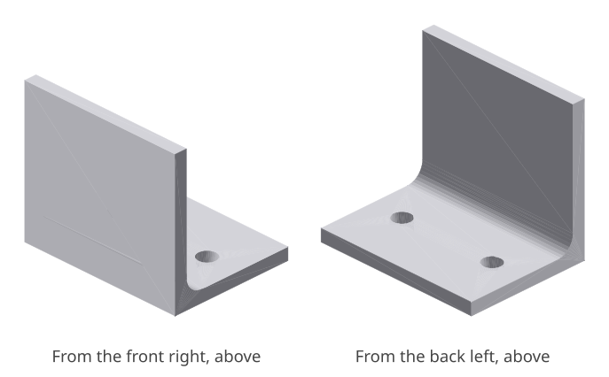
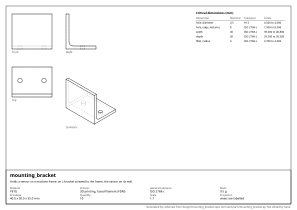

# mounting_bracket: design report

_Holds a sensor on a machine frame: an L-bracket screwed to the frame, the sensor on its wall._

## What it is

- **Material:** PETG
- **Process:** 3D printing, fused filament (FDM)
- **General tolerance:** ISO 2768-c
- **Mass:** 9.5 g
- **Envelope:** 40.0 x 30.0 x 35.0 mm
- **Quantity:** 10
- **Appearance:** not seen, not touched

## Requirements and their evidence

| ID | Requirement | Evidence |
|---|---|---|
| R1 | Two M4 screws pass through the base. | test `tests/test_mounting_bracket.py::test_two_m4_clearance_holes`; `hole_diameter_mm` = 4.5 mm, H13 (ISO 273): 4.500 to 4.680 |
| R2 | It fits the space beside the frame and is light enough for the sensor arm. | measured 40.0 x 30.0 x 35.0 mm, within 40 x 33 x 35 mm; 9.5 g, at most 15 g |
| R3 | It prints as one solid. | test `tests/test_mounting_bracket.py::test_it_is_one_printable_solid` |
| R4 | It carries the sensor without yielding, and the sensor moves less than 1 mm. | L1: safety factor 4.3 (needs 2); L2: safety factor over 100 (needs 2) |

## Interfaces

| ID | Mates with | Dimensions | Fit |
|---|---|---|---|
| I1 | M4 socket head screws into the frame | `hole_diameter_mm`, `hole_edge_distance_mm` | clearance, medium |
| I2 | the top face of a 20 x 20 frame rail | `width_mm`, `depth_mm` | flat on flat |

## Critical dimensions

| Dimension | Nominal | Tolerance | Limits | Standard | For |
|---|---|---|---|---|---|
| `hole_diameter_mm` | 4.5 mm | H13 (ISO 273) | 4.500 to 4.680 | clearance hole M4 | I1, R1 |
| `hole_edge_distance_mm` | 8 mm | ISO 2768-c | 7.500 to 8.500 |  | I1 |
| `width_mm` | 40 mm | ISO 2768-c | 39.200 to 40.800 |  | I2 |
| `depth_mm` | 30 mm | ISO 2768-c | 29.500 to 30.500 |  | I2 |
| `fillet_radius_mm` | 4 mm | ISO 2768-c | 3.700 to 4.300 | radius |  |

## Manufacturability

- **3D printing, fused filament (FDM)**: no findings.

## Strength

| Load | What | Calculation | Result |
|---|---|---|---|
| L1 | The sensor and its cable pulling sideways on the top of the wall. | cantilever: 10 N at the end of 35 mm, rectangle 40 x 3 mm: 5.8 MPa, 25 MPa allowed (PETG, 50 MPa x 0.5 for 3D printing, fused filament (FDM)); safety factor 4.3, needs 2; it moves 0.76 mm, 1 mm allowed | carried |
| L2 | The same force, carried into the frame by the two screws. | screws in shear: 10 N across 2 x M4 (8.8): 0.6 MPa in shear, 370 MPa allowed; safety factor over 100, needs 2 | carried |

Hand calculations for a straight member of constant section under a static load (`standards/strength.py`): a first check, not an analysis. Fatigue, creep, impact, buckling and the stress around details are not covered.

## Cost

No cost estimate: the project has no `design/costs.toml` with its rates.

<!-- generated by codecrew; inputs: b6f37cb0844b1aaf -->
